## Tax evasion through input overreporting

\keep

- VAT allows firms to deduct taxes paid on their purchases from the taxes collected on sales
- By overreporting their inputs, firms can reduce their tax bill
- Input overreporting is widespread: a common practice and a concern among OECD countries [[@OECD2017]]{.sm}
  - Losses of 1.2--2.7% of total tax revenue in Chile, Colombia, Ecuador, Poland and Slovakia
  - Conditional on detected evasion: true losses are plausibly larger
- Governments have limited resources, and overreporting costs the government tax revenue

\medskip

**Question:** Can we detect and measure tax evasion through input overreporting? How much does overreporting of inputs cost the government?

## Why is it difficult to detect?

\keep

- Overreporting is unobserved: firms conceal their actions because it is illegal
- Tax-evading firms might *pass* as low-productivity firms
- For a given level of output, high input use by a firm might be because the firm is overreporting or because its productivity is low

## What have people done?

\keep

- **Transaction-level data and administrative records** [[@Carrillo2022; @Zumaya2021]]{.sm}
  - False invoicing, ghost-firm invoices, invoice mills
  - Access to this data is restricted; it is conditional on detected evasion
- **On the consumer side:** a benchmark group to measure misreporting from potentially evading individuals [[@Pissarides1989; @Gorodnichenko2009]]{.sm}
  - Self-employed vs. employees
  - The self-employed might underreport their income to pay less income tax; employees cannot misreport because their income is reported by their employers
  - Consumption is a function of true income: comparing their consumption backs out how much the self-employed underreport

## The natural analogue for firms: output

\keep

- Output is a function of true inputs [(assuming output is correctly reported)]{.sm}
- If we knew the production function (PF) and productivity, we could back out true inputs: the difference between reported and true inputs is the overreporting
- However, we rely on *reported inputs* to recover the PF and productivity
  - Proxy-variable methods rely on the *flexible* input [[@Levinsohn2003; @Ackerberg2015; @Gandhi2020]]{.sm}
  - If the flexible input is deductible, firms might overreport it: materials, in my application
- We have to solve the problem simultaneously, for overreporting and productivity

## What do I do?

\keep

- Instead of looking into the PF equation, I take the FOC of the firm's profit-maximization problem
- The FOC links the materials share of revenue to the materials elasticity of output, up to measurement error
  - It does not depend on productivity (Hicks-neutral productivity)
- Just like in the individuals' case, I estimate this elasticity from a benchmark group of firms that do not overreport
  - The benchmark group can have different productivity than the potentially tax-evading firms
  - The critical assumption: both share a common technology
- With the elasticity at hand, the difference between reported and true materials reveals the overreporting, up to measurement error

## What do I find?

\keep

Colombian manufacturing, 1981--1991:

1. **Detect:** overreporting in 9 of the 18 industries liable for the sales tax (about two fifths of manufacturing output); none in the 2 exempt food industries
2. **Measure:** potentially tax-evading firms overreport on average 4.5--23.1% of their true materials, depending on the industry
3. **Cost:** undetected overreporting costs 4.7% of gross sales-tax revenue; a 1% increase in the rate on purchases lowers net sales-tax revenue by about 1.7% of gross sales-tax revenue
4. **Productivity:** failing to correct for overreporting leads to biased estimates of the PF and productivity

## Setting: Colombia, 1981--1991

- Annual Survey of Manufacturing (EAM): a panel of manufacturing plants with more than 10 employees
  - Output and inputs, juridical organization, and the sales tax charged on sales and paid on purchases
- The Colombian sales tax worked as a VAT: manufacturers credited the tax paid on their purchases against the tax charged on their sales
- The credit rewards overreporting materials: each fictitious peso lowers the tax liability by the rate on purchases
  - Capital goods could not be credited and labour was not a taxed purchase
- Weak enforcement: tax evasion flourished, and the tax authority audited inefficiently [[@Sanchez1994; @Perry1990]]{.sm}
- Food products (311, 312) were exempt from the sales tax: almost no reward to overreporting

## The benchmark group: corporations

\keep

- Two kinds of scrutiny restrained corporations from overreporting: government and market
  - Government: the Superintendent of Corporations closely supervised corporations and required each to have an auditor [[@FiscalSurveyColombia1965]]{.sm}
  - Market: tradable shares subject corporations to market discipline; the market penalizes aggressive tax behaviour even when it is legal [[@HanlonSlemrod2009]]{.sm}
- Limited liability companies (LLCs) and proprietorships faced only the tax authority, whose audits were weak
- Ecuador: tax evaded through fictitious purchases was 1.7% for corporations and 11.5% for sole proprietorships [[@Carrillo2022]]{.sm}
  - If corporations nonetheless overreport, my estimates are a lower bound
- Corporations have different productivities than the rest of the firms. But that's OK: the critical assumption is a common technology

## Model: firms, taxes and overreporting

\keep

- Price-taking firms maximize expected after-tax profits; they share a common technology but differ in productivity
$$
Y_{it}=K_{it}^{\alpha_K}L_{it}^{\alpha_L}M_{it}^{\beta}\exp(\omega_{it}+\varepsilon_{it})
$$
  - $\omega_{it}$: productivity, known to the firm; $\varepsilon_{it}$: measurement error in output
- Materials are flexible and deductible; firms report $M^*_{it}=M_{it}+e_{it}$, $e_{it}\ge0$
  - Overreporting is detected with a probability $q(e)$ and costs $\kappa(e,\omega)$; both are zero for a firm that does not overreport

## Model: the firm's problem

\keep

$$
\begin{aligned}
  \max_{M,e,K,L}\;\mathbb{E}[\pi_{it}] = \;&(1-\tau_S)P_t E_{\varepsilon}[K_{it}^{\alpha_K}L_{it}^{\alpha_L}M_{it}^{\beta}\exp(\omega_{it}+\varepsilon_{it})]\\
  &-(1-\tau_P)\rho_tM_{it}-r_tK_{it}-w_tL_{it}\\
  &+\tau_P\rho_te_{it}\big[1-(1+\phi)q(e_{it})\big]-\kappa_{it}(e_{it},\omega_{it})
\end{aligned}
$$

- Revenue net of the tax on sales; the cost of true materials net of the credit on them; the rental cost of capital and the wage bill
- The credit on overreported materials net of the expected repayment and fine; the cost of evasion
- Underreporting would increase the tax liability: no firm has an incentive to do so, $e_{it}\ge0$

## Model: the materials FOC

\keep

- The FOC with respect to materials gives the log share of materials in revenue, net of sales taxes:
$$
\ln\left(\frac{(1-\tau_P)\rho_tM_{it}}{(1-\tau_S)P_tY_{it}}\right)=\ln\beta-\varepsilon_{it}
$$
  - Productivity does not appear in the share (Hicks-neutral productivity)
- With reported materials $M^*_{it}$, the log share $s_{it}$ satisfies
$$
s_{it}=\ln\beta-\varepsilon_{it}+u_{it},\qquad u_{it}=\ln(M^*_{it}/M_{it})\ge0
$$

## Testing for overreporting

- Corporations do not overreport: $s_{it}=\ln\beta-\varepsilon_{it}$ gives $\ln\beta=E[s_{it}\mid\text{corporations}]$
- Unincorporated firms (LLCs, proprietorships): the observed residual $\mathcal V_{it}=s_{it}-\ln\beta=u_{it}-\varepsilon_{it}$
$$
H_0:\ \mu_{\mathcal V}=0\qquad\text{vs.}\qquad H_1:\ \mu_{\mathcal V}>0
$$
- One-sided: no firm has an incentive to underreport deductible inputs. A rejection can only point to overreporting
- The test does not depend on the functional forms of the detection probability and the cost of evasion, nor on the Cobb-Douglas form of the technology
- Confidence set for $\mu_{\mathcal V}$ by test inversion, clustered by plant

## Testing results

\keep

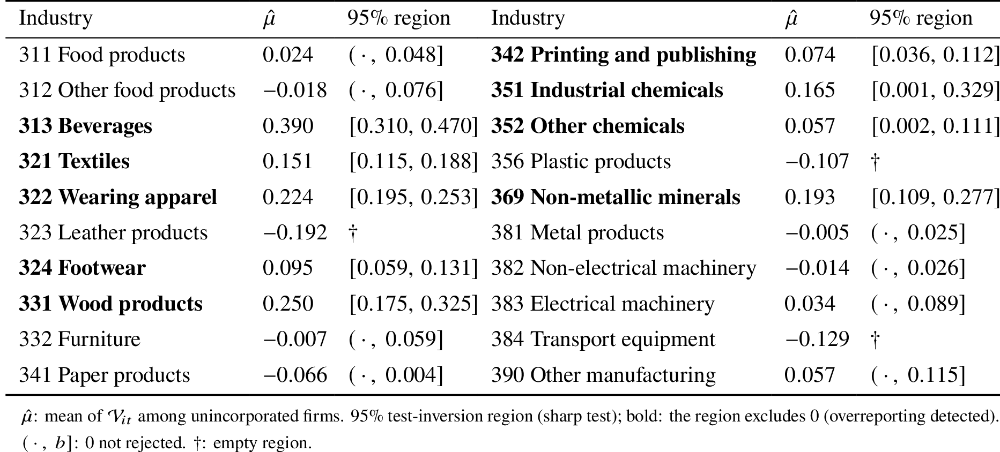{height=65% fig-align="center"}

\small

- The test detects overreporting in 9 of the 18 industries liable for the sales tax: 4 of the 5 largest by output; 41% of manufacturing output

## Testing results

\keep

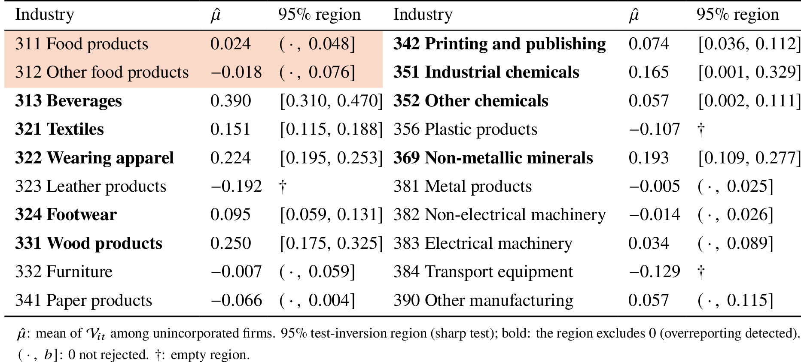{height=65% fig-align="center"}

\small

<!-- - The test detects overreporting in 9 of the 18 industries liable for the sales tax: 4 of the 5 largest by output; 41% of manufacturing output -->
- No overreporting in either exempt industry, Food products (311) and Other food products (312): this is expected

## Counterfactual: the rate on purchases

\keep

- How does net sales-tax revenue change as the government changes the sales-tax rate on purchases?
- Expected net sales-tax revenue from firm $i$ at the new rate $\tilde\tau_{P}=(1+\Delta)\tau_{P}$:
$$
R_i(\Delta;M_i) = \underbrace{\tau_{S}P_tY_{it}(\Delta)}_{\text{gross sales-tax revenue}} - \underbrace{\tilde\tau_{P}\big[M_{it}(\Delta)+(1-q(\tilde{e}_i(\Delta)))\tilde{e}_i(\Delta)\big]}_{\text{claimed deductions}}
$$
- A change in the rate moves net sales-tax revenue through three channels:
  1. Mechanical: every peso the firm claims is credited at the new rate
  2. Overreporting: a higher rate raises the marginal benefit of overreporting
  3. Materials: the rate changes the net-of-tax price of materials relative to output

## The overreporting response: the evasion condition

\keep

- To compute the undetected overreporting at the new rate, $(1-q(\tilde e_i))\tilde e_i$, we need the firm's FOC with respect to $e$:
$$
\underbrace{\tau_P\rho_t\big[1-(1+\phi)\big(q(e_{it})+q'(e_{it})e_{it}\big)\big]}_{\text{marginal benefit}}=\underbrace{\frac{\partial\kappa_{it}(e_{it},\omega_{it})}{\partial e_{it}}}_{\text{marginal cost}}
$$
- A higher tax rate on purchases raises overreporting
- The cost of evasion depends on productivity, which lets the model match the observed pattern in recent evidence [[@Carrillo2022]]{.sm}
- Estimating $q(e)$ and $\kappa(e,\omega)$ requires the latent true materials

## One unobservable: true materials

\keep

- I cast the estimation problem in terms of a single unobservable, true materials $M$:
$$
e(M)=M^*_{it}-M,\qquad\varepsilon(M)=\ln(M^*_{it}/M)-\mathcal V_{it},
$$
$$
\omega(M)=\tilde{\mathcal W}_{it}-(1-\beta)\varepsilon(M)
$$
  - $\mathcal V_{it}$: the observed residual of the test; $\tilde{\mathcal W}_{it}$: from the production-function estimates
  - The evasion condition then gives the cost shock $\psi(M)$
- The model's independence assumptions give the moment conditions $E[g(M,Z,\theta)]=0$, e.g. $E[\psi]=0$, $E[\psi\ln\tau_P]=0$, $E[\varepsilon]=0$
  - $Z$: observables; $\theta$: the parameters of $q$ and $\kappa$
- I estimate the model with *ELVIS*, Entropic Latent Variable Integration via Simulation
  
## ELVIS: existence and optimization

\keep

- Is there a distribution of $M$ given $Z$ with $E[g]=0$?
- Theorem 2.1 of @Schennach2014: the existence problem is equivalent to an optimization problem
$$
\inf_{f_{M|Z}}\big\|E[g(M,Z,\theta)]\big\|=0\iff\inf_{\gamma}\big\|E[\tilde g(Z,\theta,\gamma)]\big\|=0,
$$
$$
\tilde g(Z,\theta,\gamma)=\frac{\int g(M,Z,\theta)\,e^{\gamma'g(M,Z,\theta)}f^0_{M|Z}(M|Z)\,dM}{\int e^{\gamma'g(M,Z,\theta)}f^0_{M|Z}(M|Z)\,dM}
$$
- Among the conditional distributions of $M$ given $Z$ that satisfy the moment conditions, ELVIS selects the one with maximum entropy relative to a reference density $f^0_{M|Z}$; $\gamma$ is the Lagrange multiplier on the moment constraints
- Test: $TS_n=2n\hat L_n(\theta)$ against $\chi^2_{d_g}$ (conservative, Theorem F.1)

<!-- ## Estimation: ELVIS {.shrink}

\keep

I estimate the model with ELVIS, Entropic Latent Variable Integration via Simulation [[@Schennach2014]]{.sm}

:::: {.columns}
::: {.column width="56%"}
\footnotesize

**What is ELVIS?**

- A method of simulated moments where we use Markov chain Monte Carlo (MCMC) methods to sample from a non-parametric distribution of the unobservables conditional on the observables, such that the moment conditions hold
- It turns an existence question into an optimization problem: instead of asking "is there a distribution of the unobservables conditional on the observables such that the moments hold?", it asks "what is the distribution of the unobservables conditional on the observables that maximizes entropy?"
- Why do we care about entropy? We don't. We just need a distribution that satisfies the moment conditions
- ELVIS is always going to find a distribution: we test whether the moments are equal to zero
:::
::: {.column width="44%"}
\footnotesize

**Why ELVIS?**

- Moments are nonlinear in the unobservable, true materials. So a standard GMM or instruments/2SLS would not work
- We could assume a parametric distribution (indirect inference, maximum simulated likelihood). ELVIS does not impose parametric assumptions on the distribution of the unobservables
:::
::::
 -->

## The counterfactual as a moment

\keep

- If we can write our counterfactual as a moment condition, then we can use ELVIS to answer the counterfactual
- Add the counterfactual moment, with an auxiliary parameter $T$, to the set of moments: $E\big[R_i(\Delta;M_i)-T\big]=0$
- For each $T$: is there a distribution of the unobservables conditional on the observables that satisfies the model's moments AND the counterfactual moment? Yes or no
  - The confidence set collects the values of $T$ that the test does not reject
- Why a set: the entropy-maximizing distribution should not be treated as the actual distribution of $M$, since many conditional distributions of $M$ given $Z$ may satisfy the moment condition [[@Schennach2022]]{.sm}
  - "Latent variable models are often set-identified" [[@Schennach2014, p. 346]]{.sm}

## Results: net sales-tax revenue

\keep

:::: {.columns}
::: {.column width="55%"}
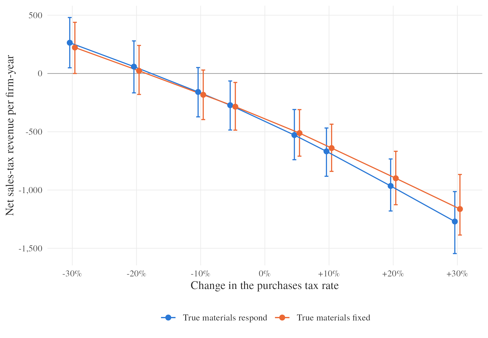{width=100%}
:::
::: {.column width="45%"}
\small

Real pesos per firm-year, unincorporated firms in the 9 industries where the test rejects

- Current rate: $-391$ $[-605,-174]$: refunds on claimed deductions exceed gross sales-tax revenue
- Breaks even at a cut of about 17%; significantly positive from a cut of 27.5% $[2, 426]$

:::
::::

## Results: elasticity and the cost

\keep

- Elasticity: A 1% increase lowers net sales-tax revenue by about 1.7% of gross sales-tax revenue $[1.47, 1.91]$
- Cost: 
  - Undetected overreporting costs 4.7% $[2.8, 7.1]$ of gross sales-tax revenue from the unincorporated firms in the 9 industries
  - At least 1.5% $[1.1, 3.1]$ across all firms in the sample
  - Same order of magnitude as what tax authorities have detected from input overreporting: 1.2--2.7% of total tax revenue in five countries [[@OECD2017; @Carrillo2022; @CASE2018; @Pelaez2022]]{.sm}

## Conclusion

\keep

- Can we detect and measure tax evasion through input overreporting? How much does it cost the government?
- Overreporting can be detected and measured from production data and a benchmark group alone
- It is common and large
- It is costly in two ways: for the government, which credits fictitious purchases, and for productivity measurement
- A higher rate on purchases raises claimed deductions by more than its mechanical effect: 
  - net sales-tax revenue falls by more than the higher credit alone implies

# Appendix {.plain .noframenumbering}

## Model estimates {.plain .noframenumbering}

:::: {.columns}
::: {.column width="45%"}
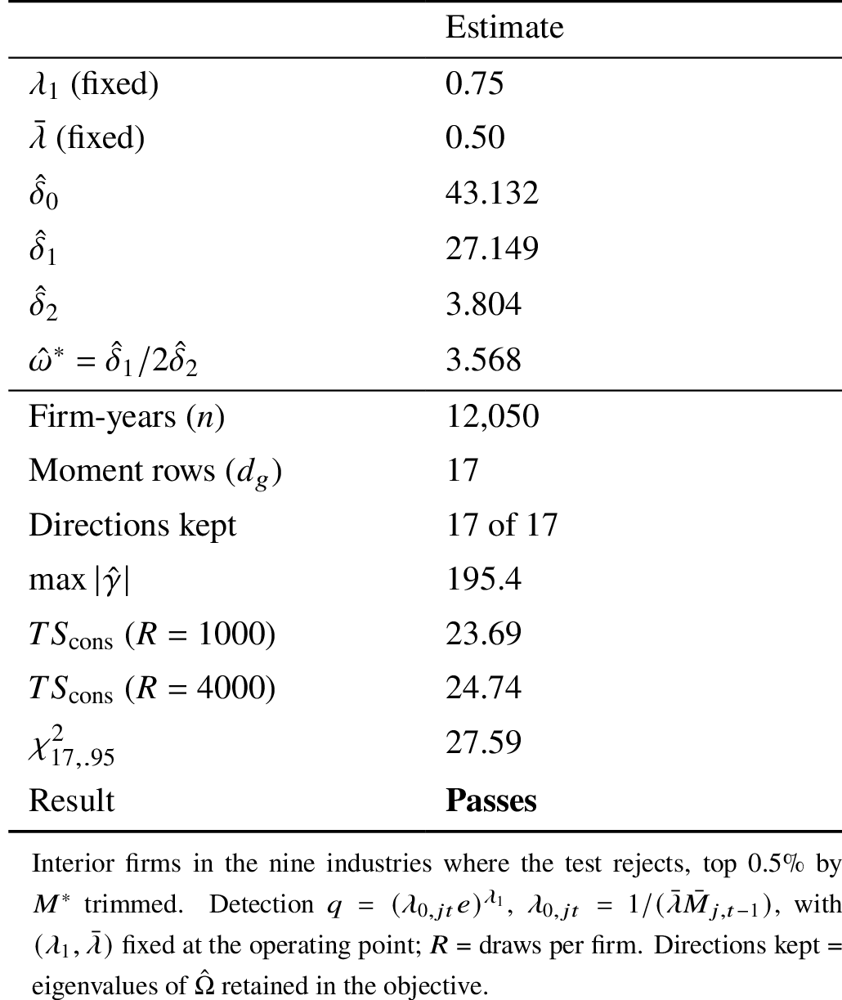{height=78%}
:::
::: {.column width="55%"}
\small

- Interior firms in the nine industries where the test rejects; the test statistic $TS_n$ fails to reject at the 5% level
- Cost of evasion convex in productivity: $\hat\delta_1=27.15>0$, $\hat\delta_2=3.80>0$; it falls with productivity up to $\hat\omega^*=3.57$ (about the 57th percentile) and rises after it
- Mean detection probability 6.8% $[5.7, 11.0]$; median 2.0%, 80th percentile 18.5%, 90th percentile 27%, maximum 57%
- The model's mean overreporting $E[u]$ is within 0.02 of the data's $E[\mathcal V]$ in seven of the nine industries
:::
::::

## Claimed deductions: elasticities {.plain .noframenumbering}

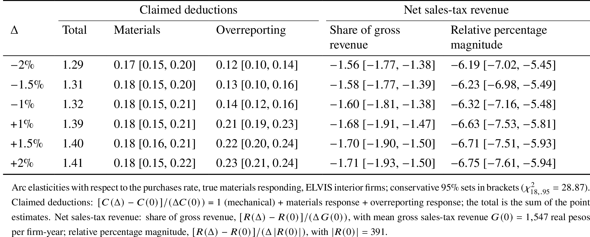{width=85% fig-align="center"}

\small

- Claimed purchase deductions respond more than one for one: $+1\%$ $\to$ 1.39 $=$ 1 (mechanical) $+$ 0.18 (materials) $+$ 0.21 (overreporting)
- At $-1\%$: 1.32; the materials response is again 0.18, but the overreporting response falls to 0.14

## Net sales-tax revenue: whole economy {.plain .noframenumbering}

:::: {.columns}
::: {.column width="58%"}
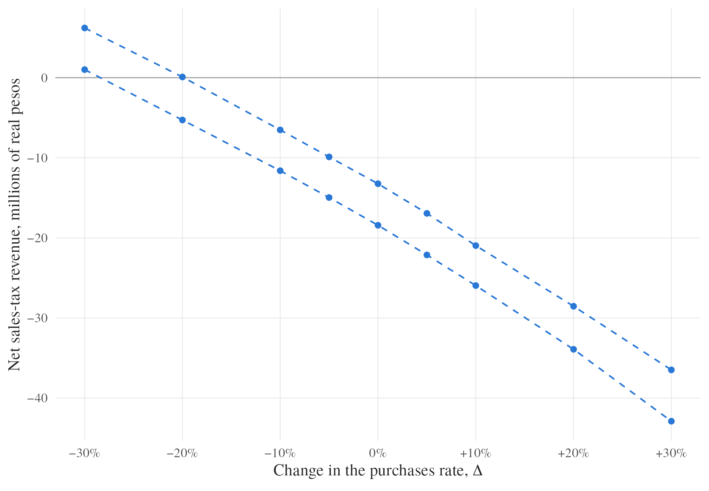{width=100%}
:::
::: {.column width="42%"}
\small

Total over every firm-year in the sample, millions of real pesos

- Current rate: $-15.9$ $[-18.4,-13.2]$
- Breaks even at a cut of about 24%; a 30% cut raises it to 3.6 $[1.0, 6.2]$
- The whole economy needs a larger cut because of the corner firms in the other 19 industries
:::
::::

## Robustness: true materials fixed {.plain .noframenumbering}

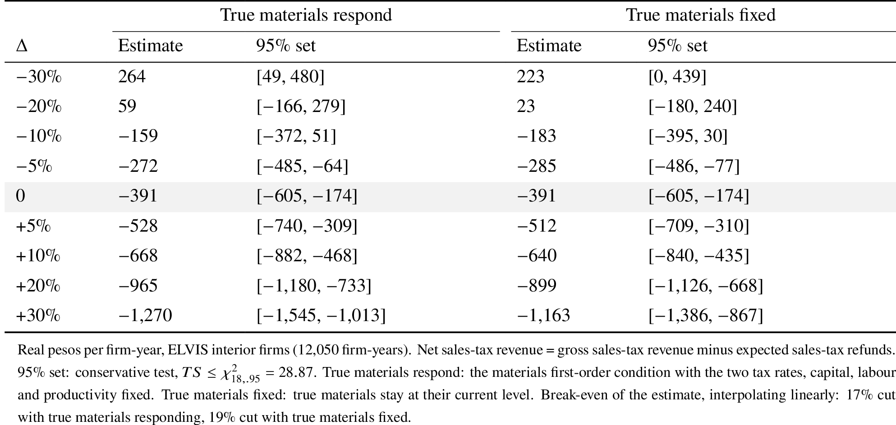{width=85% fig-align="center"}

## Test for overreporting: conservative test {.plain .noframenumbering}

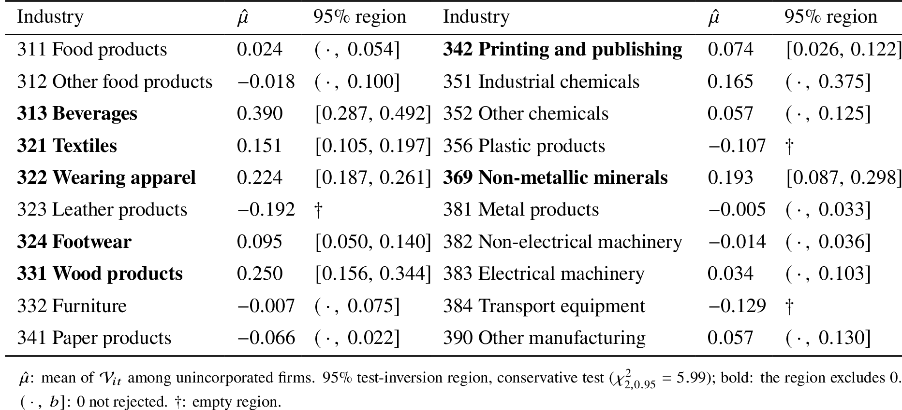{width=90% fig-align="center"}

## How much: deconvolution {.plain .noframenumbering}

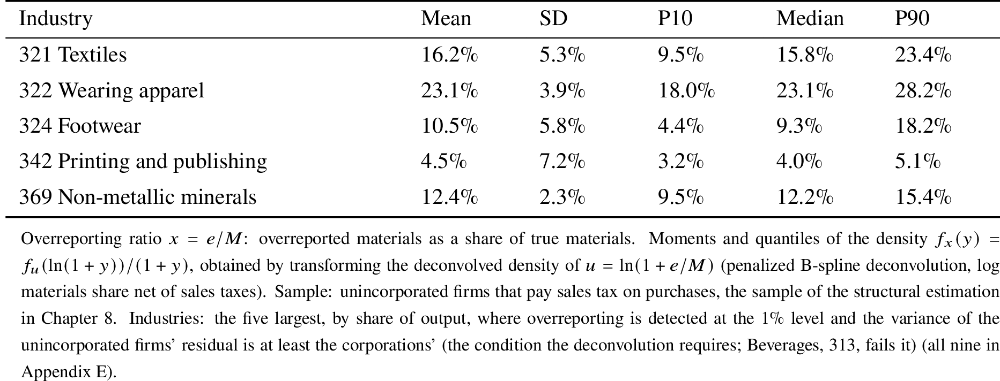{width=90% fig-align="center"}

\small

- In the five largest industries where the test rejects at the 1% level and the deconvolution applies, unincorporated firms overreport on average between 4.5 and 23.1% of their true materials

## Production function estimates {.plain .noframenumbering}

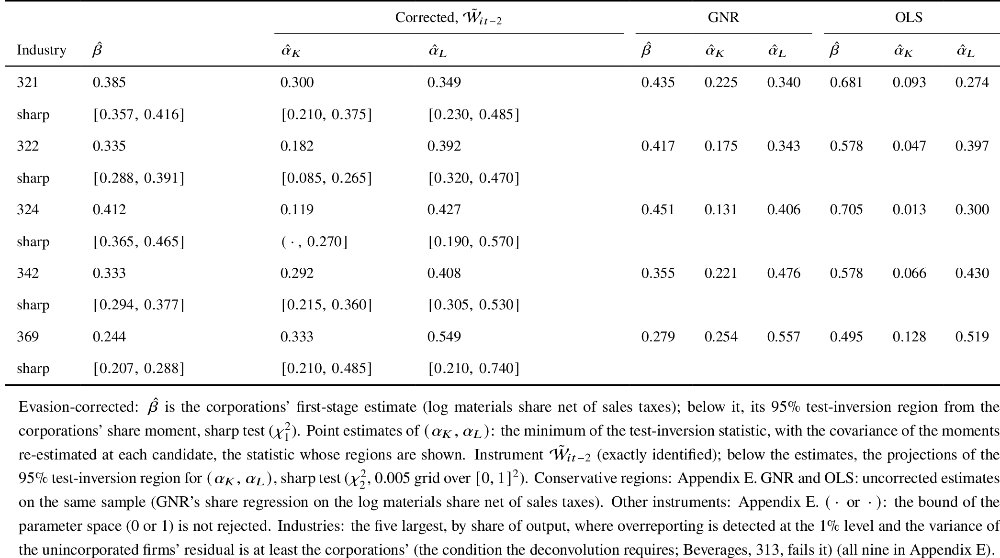{height=72% fig-align="center"}

\small

- The uncorrected estimates show output elasticities of materials that are consistently larger than the corrected ones

## Productivity {.plain .noframenumbering}

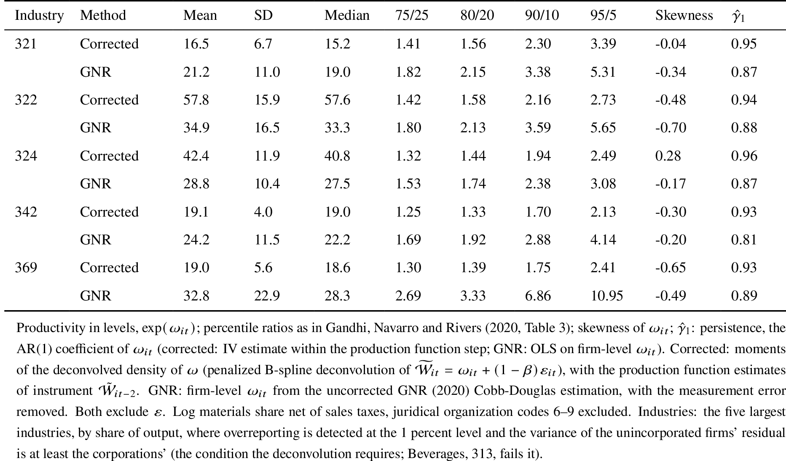{height=68% fig-align="center"}

\small

- Uncorrected productivity distributions are more dispersed and less persistent: in the median of the five industries, the 90/10 ratio is 66% larger and the half-life of productivity shocks is 63% shorter

## The 1983 reform {.plain .noframenumbering}

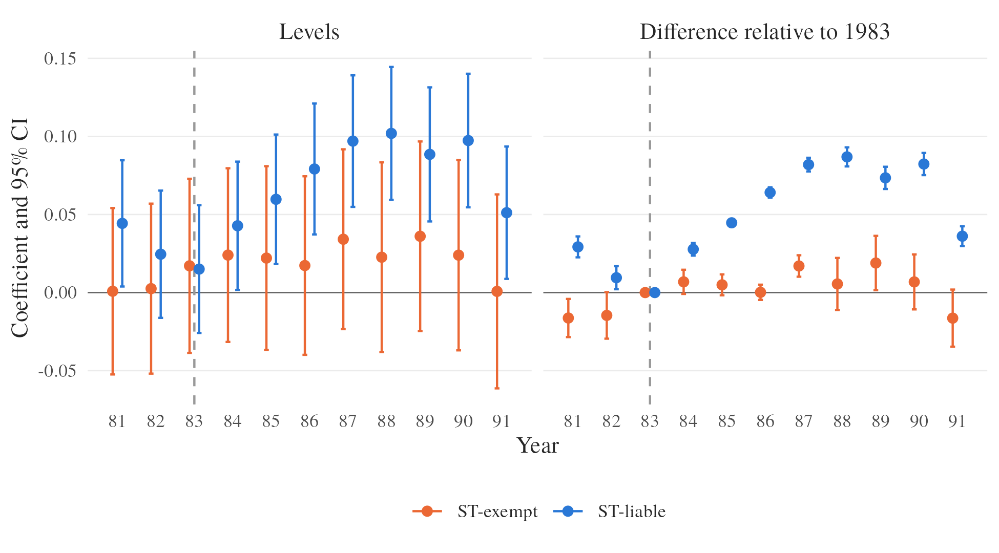{height=68% fig-align="center"}

\small

- Between 1983 and 1987, after Colombia raised the sales-tax rate for most manufacturing industries, overreporting by unincorporated firms in the affected industries rose by about 8.5 percentage points of true materials

## The 1983 reform: elasticity {.plain .noframenumbering}

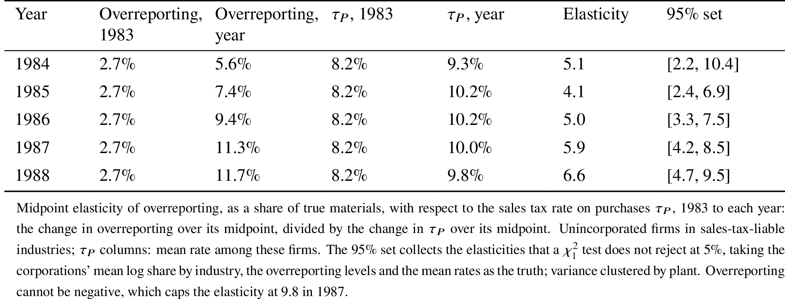{width=90% fig-align="center"}

\small

- The response implies a midpoint elasticity of overreporting with respect to the tax rate of 5.9

## Overreporting elsewhere: Ecuador and Mexico {.plain .noframenumbering}

\small

- **Share of true purchases.** Ecuador: among firms that use ghost receipts, ghost purchases are 10.4% of the value of their purchase deductions [(3.6% of their purchases)]{.sm}
  - Mine: unincorporated firms overreport 4.5--23.1% of their true materials on average
- **Losses.** Detected losses 1.2--2.7% of total tax revenue in Chile, Colombia, Ecuador, Poland and Slovakia [[@OECD2017; @Carrillo2022; @CASE2018; @Pelaez2022]]{.sm}
  - Mine: 4.7% of gross sales-tax revenue (interior firms), 1.5% (all firms)
  - Theirs count only what enforcement detects: true losses plausibly larger
- **Corporations as benchmark.** Ecuador: tax evaded through fake receipts 1.7% for corporations vs 11.5% for sole proprietorships [[@Carrillo2022, p. 6]]{.sm}
- **Pattern by size.** Ecuador: share of deductions backed by fake receipts rises with revenue, drops sharply at the very top [[@Carrillo2022, p. 6]]{.sm}
  - Mine: cost of evasion convex in productivity, minimum at $\hat\omega^*=3.57$ ($\approx$ 57th percentile)

## References {.allowframebreaks .plain .noframenumbering}

::: {#refs}
:::
